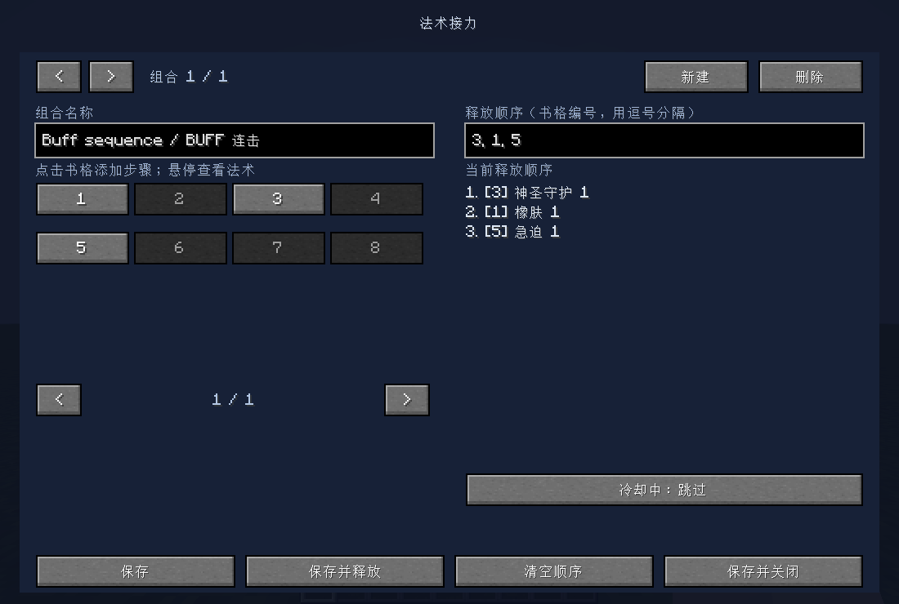
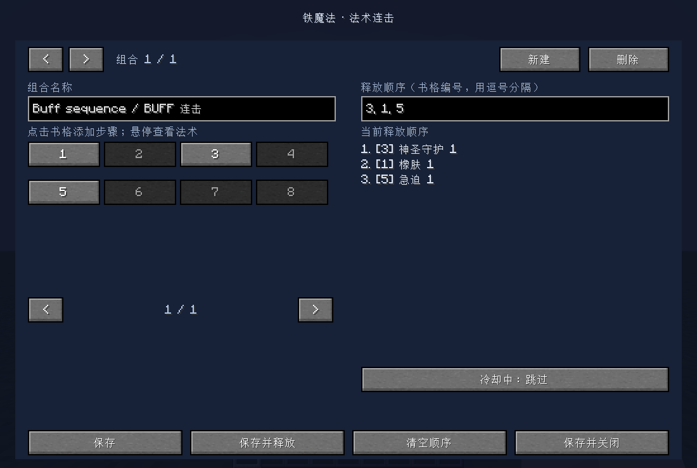

# Spell Relay · 法术接力/法术连携

A client-side spell sequence addon for **Iron's Spells 'n Spellbooks**. Configure the order using physical spellbook slots, then press one key to cast each spell in turn. The next spell waits for the server's native cast-completion acknowledgement.

This is an unofficial addon. Spell Relay is installed on the client; the server needs the original Iron's Spells and its dependencies, but does not need Spell Relay.

## Versions

| Minecraft | Loader | Tested Iron's Spells | Project |
| --- | --- | --- | --- |
| 1.20.1 | Forge 47.4.13 | 1.20.1-3.15.4 | [Forge source and build instructions](forge-1.20.1/) |
| 1.21.1 | NeoForge 21.1.250 | 1.21.1-3.16.3 | [NeoForge source and build instructions](neoforge-1.21.1/) |

Download the matching JAR from **[Releases](https://github.com/EchoAria/SpellRelay/releases)** and put it in your client's `mods` folder. Install the original mod and its required dependencies separately. Use only the build matching your Minecraft version and loader.

The initial NeoForge build retains its original file/display name, **Iron Auto Spell**. Both builds use the `ironautospell` mod ID and `config/ironautospell.json` configuration format.

## Controls and features

- **F8:** open the local sequence editor.
- **F9:** start or stop the selected sequence; key bindings can be changed in Minecraft controls.
- Click spellbook slots or type a sequence such as `3, 1, 5`. Slots are one-based physical positions, including empty slots.
- Multiple named profiles; spell names and levels are previewed in the editor.
- Choose whether cooling spells are skipped, waited for, or stop the sequence.
- Uses Iron's own quick-cast packets. Normal mana, cooldown and spell eligibility checks still apply on the server.
- Stops on interruption, invalid slots, manual use/attack input, book changes, death or disconnect.

Continuous/channeling spells are currently unsupported. Active recast states stop the sequence to avoid dismissing summons or toggling effects. Stopping the queue leaves an already-started cast to finish naturally. No automatic aiming or endless buff-refresh loop is included. Compatibility with every modpack or third-party spell has not been verified. The Forge build does not support the older Iron's Spells 3.4.x API.

## 中文说明

这是铁魔法的客户端附属模组。按 **F8** 打开设置，按法术书里的实际书格编号设置顺序，例如 `3,1,5`；保存后按 **F9** 开始或停止。每次只请求一招，等待服务端确认吟唱结束后再接下一招，适合依次施放多个 BUFF。

服务器无需安装法术接力，但原版铁魔法及其前置应正常安装。两个版本的工程、依赖文件名和构建方法见上表链接。第三方依赖未包含在本仓库内。

## Screenshots

Forge 1.20.1:

NeoForge 1.21.1:

## Validation

Both ports have 12 passing tests of the sequence state machine. Packaged builds were tested with a separate server that did not have Spell Relay installed: F8 editor, F9 execution, physical slots 3→1→5, three successful BUFF casts, cooldown skips, empty-slot rejection and configuration persistence.

NeoForge 1.0.1 changed license packaging only; its class files were byte-identical to the game-tested 1.0.0 build. Forge 1.0.1 was tested directly as the final reobfuscated JAR.

## License and development

Own code is licensed under **MIT**. See each project's `THIRD_PARTY_NOTICES.md`, template license and `licenses/` directory for third-party notices. Minecraft, Iron's Spells and dependency mod code/assets are not redistributed here.

This project was primarily written with generative AI assistance and verified with automated tests and in-game integration tests. It is not endorsed by the Iron's Spells authors, Mojang or Microsoft.

Original mod: [Iron's Spells 'n Spellbooks](https://www.curseforge.com/minecraft/mc-mods/irons-spells-n-spellbooks), by Iron431 and Lab3.
